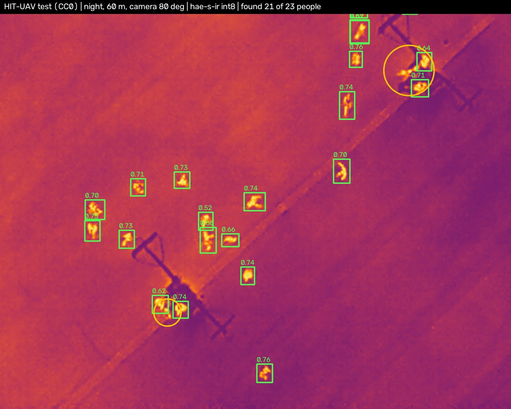
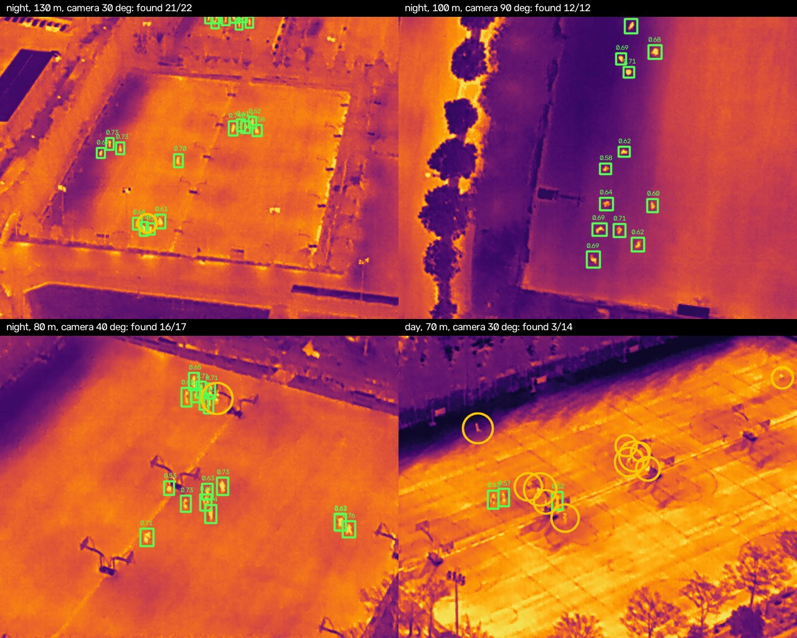

<div align="center">

# hae (해) — an open thermal person detector for search-and-rescue drones

**A 313 k-parameter model that finds people in drone thermal imagery and runs on a $15 Raspberry Pi Zero 2 W.**

**[▶ Live demo in your browser](https://huggingface.co/spaces/alexshynkarenk0/hae-demo)** · [Українська](README.uk.md) · [Model card](MODEL_CARD.md) · [Data card](DATA_CARD.md) · [Documentation](docs/en/README.md) · [Responsible use](RESPONSIBLE_USE.md)

`code: MIT` · `weights: MIT` · `v1.0.0` · `Python ≥ 3.10` · `runtime: numpy + onnxruntime (no PyTorch)`

</div>

---

<p align="center"></p>

<p align="center"><em>A real HIT-UAV test frame (night, 60 m). Green: hae-s-ir int8 detections with their scores. Orange circles: people the model missed. Reproduce with <code>scripts/make_readme_figures.py</code>.</em></p>


After floods, earthquakes and tsunamis, and when someone is lost in a forest or in the mountains, a drone with a thermal camera covers ground much faster than a search line on foot. A person seen from 50–120 m is only a few pixels tall, though, and an operator watching a live feed for hours will miss some of them. **hae** (해, Korean for "sun") is a small, fully open neural detector that flags likely people in thermal (LWIR) drone imagery. It is meant to help human searchers, not to replace them.

Everything is open: inference and training code, the trained weights (ONNX fp32 / int8 and PyTorch `safetensors`), the exact training recipe, the evaluation protocol and the annotations of every data split. The model was trained **from scratch** on openly licensed civilian datasets. No third-party pretrained checkpoints were used.

> [!IMPORTANT]
> hae is a **research release** and a **decision-support** tool. It misses people and it raises false alarms (see [Limitations](#limitations)). Never use it as the only means of search, and never use a negative result to call off a search. Read [RESPONSIBLE_USE.md](RESPONSIBLE_USE.md) before deploying.

## Contents

- [The model](#the-model)
- [Quick start](#quick-start)
- [Results](#results)
- [Speed on Raspberry Pi Zero 2 W](#speed-on-raspberry-pi-zero-2-w)
- [How it works](#how-it-works)
- [Data pool](#data-pool)
- [Training and reproduction](#training-and-reproduction)
- [Limitations](#limitations)
- [Repository layout](#repository-layout)
- [License](#license) · [Citation](#citation) · [Acknowledgements](#acknowledgements)

## The model

| | **hae-s-ir** v1.0.0 |
|---|---|
| Task | detection of people (one class) in thermal (LWIR, 8-bit grayscale) aerial frames |
| Parameters | 313,169 |
| Compute | 0.269 GMAC per 256×320 tile at ×1.0; recommended input scale ×1.5 |
| Files | `hae-s-ir_lwir_int8.onnx` **383 KB** (deployment) · `hae-s-ir_lwir.onnx` 1.2 MB (fp32) · `hae-s-ir.safetensors` (PyTorch, for fine-tuning) |
| Accuracy (int8) | AP50 **0.757** on HIT-UAV test · 0.230 on AIResQ val · 0.087 on WiSARD-IR (transfer test) |
| Speed | **55 ms** per 256×320 tile on a Raspberry Pi Zero 2 W (4 threads, measured) |
| Training | from scratch, 90 epochs, HIT-UAV + AIResQ, 42 min on one NVIDIA T4 |
| Licence | MIT |

Everything about the model is in [`models/hae-s-ir/`](models/hae-s-ir): `config.json` (architecture plus full training recipe), `metrics.json` (all evaluation numbers, including threshold sweeps) and the SHA-256 sums in [`models/SHA256SUMS`](models/SHA256SUMS).

**Why only one model?** We trained a family of sizes (n/t/s/m) and an RGB line. This release ships the model we can stand behind. hae-s-ir is the most accurate on the main thermal benchmark (it beats the 2.6× larger `m`), and it fits the compute budget of a Raspberry Pi Zero 2 W. The RGB line is not ready for release. Other variants will follow only once they clearly add value.

**Related models:** [hae-n-ir-ext-kdf](https://github.com/sashapiscivca-svg/hae-n-ir-ext-kdf) ([Hugging Face](https://huggingface.co/alexshynkarenk0/hae-n-ir-ext-kdf)), a 54 k-parameter real-time model for forest and wilderness footage, published separately; it runs with this package.

## Quick start

```bash
git clone https://github.com/sashapiscivca-svg/hae && cd hae
pip install -e .                                        # runtime only: numpy, onnxruntime, opencv, onnx, pillow
```

Command line:

```bash
hae info hae-s-ir                                       # metadata: preprocessing, scale, thresholds, licence
hae predict hae-s-ir path/to/thermal_frames/ --json     # results go to runs/predict/exp*/
hae predict hae-s-ir frame.png --preset sensitive       # higher recall, more false alarms
hae predict hae-s-ir big_frame.png --tile 256,320       # tiling for frames much larger than 640×512
```

Python:

```python
from hae.detector import Detector

det = Detector("hae-s-ir")             # scale, preprocessing and threshold come from the ONNX metadata
res = det.predict("frame.png")         # or a numpy array, a directory, or a list of paths
print(res.summary())
for (x1, y1, x2, y2), score in zip(res.boxes, res.conf):
    print(f"person {score:.2f} at ({x1:.0f},{y1:.0f})-({x2:.0f},{y2:.0f})")
res.save("frame_detections.png")
```

Without the repository, `pip install "hae[hub] @ git+https://github.com/sashapiscivca-svg/hae"` and `hae download hae-s-ir` fetch the weights from the [Hugging Face Hub](https://huggingface.co/alexshynkarenk0/hae-s-ir). Any ONNX runtime can run the files directly (C++, Rust, mobile, web). The input and output contract is described in [docs/en/inference.md](docs/en/inference.md).

## Results

The model was trained once (seed 0). Re-running the recipe moves AP50 by about ±0.02 on HIT-UAV and ±0.04–0.08 on the smaller sets. Matching uses IoU ≥ 0.5 and is class-agnostic. "FP/frame" is the number of false alarms per frame. The protocol is in [docs/en/evaluation.md](docs/en/evaluation.md).

| Evaluation set | Frames | People | AP50 fp32 | AP50 int8 | Balanced preset (0.50): recall / precision / FP per frame | Sensitive preset (0.45): recall / precision / FP per frame |
|---|---:|---:|---:|---:|---|---|
| HIT-UAV test (in-domain) | 579 | 2,611 | 0.758 | **0.757** | 0.73 / 0.75 / 1.09 | 0.77 / 0.70 / 1.50 |
| AIResQ val (in-domain, real rescue footage, people ~8 px) | 502 | 933 | 0.238 | 0.230 | 0.52 / 0.24 / 3.11 | 0.56 / 0.19 / 4.42 |
| WiSARD-IR val (**transfer**: never trained or tuned on) | 1,633 | 2,439 | 0.086 | 0.087 | 0.17 / 0.16 / 1.28 | 0.19 / 0.13 / 1.86 |



*Four HIT-UAV test frames at the balanced threshold. At night, warm people stand out and almost all of them are found. In the daytime scene (bottom right), sun-heated ground hides people: the model finds 3 of 14. Thermal detection is much harder in daylight.*

How to read this:

- On footage like HIT-UAV (the same kind of cameras, people about 19 px tall), the model finds **about three quarters of people with about one false alarm per frame**.
- On AIResQ, where people are about 8 px tall in real rescue footage, it finds about half of them, at about three false alarms per frame.
- On WiSARD-IR, which comes from other cameras and sites with larger people (median 32 px), it **largely fails**. This is the most important caveat of this release: thermal detectors do not transfer reliably between cameras and altitudes. Validate on your own footage, and fine-tune if you can.

For context: published state-of-the-art detectors with ImageNet-pretrained backbones and 100–1000× more compute reach about 0.50 mAP50 on the related RGBTDronePerson benchmark. hae does not compete with them on accuracy. It targets hardware that has only a few hundred kilobytes of model budget and a single low-power CPU.

## Speed on Raspberry Pi Zero 2 W

Measured **on the device** (Raspberry Pi Zero 2 W Rev 1.0, Raspberry Pi OS Bookworm 64-bit, Python 3.11, onnxruntime, `performance` governor, no heatsink). Times are p50.

| hae-s-ir | 1 thread | 4 threads |
|---|---:|---:|
| int8, one 256×320 tile | 148 ms | **55 ms** |
| fp32, one 256×320 tile | 208 ms | 82 ms |
| int8, full 640×512 frame at ×1.5 | 1411 ms | 554 ms |

Without a heatsink, the board reached 81.7 °C after five minutes on all four cores and throttled, so use a heatsink in flight. For live video, run the detector every *K* frames, track between detections, and lower the input scale when people appear large. Details and the benchmarking command (`scripts/bench.py`) are in [docs/en/deployment-raspberry-pi.md](docs/en/deployment-raspberry-pi.md).

## How it works

```
thermal frame ─► per-frame z-score ─► ×1.5 upscale ─► [optional tiling]
   ─► stem (space-to-depth + 3×3, stride 4) ─► Ghost-block backbone (strides 4/8/16 + stride-32 context)
   ─► top-down neck ─► stride-4 head: person logit + (l,t,r,b) per cell
   ─► 3×3 peak picking + softplus box decoding (numpy) ─► [x1,y1,x2,y2,score,class]
```

The detector is a dense, anchor-free, single-stage design. Each cell of a stride-4 grid predicts a "person centre" score and the distances to the four box sides. It is trained with Quality Focal Loss (the score target is the IoU) plus GIoU and NWD box losses, which keeps gradients useful for boxes a few pixels wide. The design was written from scratch and draws on published ideas (CenterNet, FCOS, Generalized Focal Loss, GhostNet, NWD and SAHI; see [NOTICE.md](NOTICE.md)). The int8 model keeps the two final 1×1 head convolutions in fp32. Details: [docs/en/architecture.md](docs/en/architecture.md).

## Data pool

hae is trained and evaluated only on **civilian, openly licensed** thermal data whose licence allows commercial use and derivative works:

| Dataset | Licence | Split in the pool | Frames | People | Role |
|---|---|---|---:|---:|---|
| [HIT-UAV](https://zenodo.org/records/7633134) | CC0 1.0 | `hituav_trainval` | 2,319 | 9,701 | training (60 % of crops) |
| | | `hituav_test` | 579 | 2,611 | test |
| [AIResQ Benchmark](https://zenodo.org/records/17405074) | CC BY 4.0 | `airesq_train` | 1,486 | 1,710 | training (40 %) |
| | | `airesq_val` | 502 | 933 | validation |
| [WiSARD](https://sites.google.com/uw.edu/wisard) (thermal) | MIT | `wisard_ir_val` | 1,633 | 2,439 | transfer test only |

The **exact annotations** of every split (COCO JSON) are in [`data/annotations/`](data/annotations). We do **not** re-host the images: you download each dataset from its official source, and `scripts/prepare_data.py` converts it and aligns the frames to the published annotations, so anyone can rebuild exactly the data the model saw. The [DATA_CARD.md](DATA_CARD.md) documents sources, licences, attribution, split rules, statistics, known label issues, and the datasets we rejected and why (non-commercial terms, unclear licence, military origin).

## Training and reproduction

```bash
pip install -e ".[train]"                                       # adds PyTorch, pycocotools, tensorboard, pyyaml, safetensors
python scripts/prepare_data.py sources                          # where to download each dataset, and its licence
python scripts/prepare_data.py hituav    --src ~/dl/HIT-UAV --out data
python scripts/prepare_data.py airesq    --src ~/dl/AIResQ  --out data
python scripts/prepare_data.py wisard-ir --src ~/dl/WiSARD  --out data
python scripts/train.py    --config configs/hae-s-ir.yaml --data data --out runs/hae-s-ir
python scripts/export.py   --checkpoint runs/hae-s-ir/last.pt --config configs/hae-s-ir.yaml --data data --out models-local/hae-s-ir
python scripts/evaluate.py --model models-local/hae-s-ir/hae-s-ir_lwir_int8.onnx --data data --sets hituav_test,airesq_val,wisard_ir_val
```

[`configs/hae-s-ir.yaml`](configs/hae-s-ir.yaml) is the recipe of the released model, taken from its training checkpoint (the random sampling order differs slightly from the original run, so retraining reproduces the model statistically, not bit for bit). Training took 42 minutes on one NVIDIA T4. CPU training works but is slow. To fine-tune on your own camera, start from `models/hae-s-ir/hae-s-ir.safetensors`. See [docs/en/training.md](docs/en/training.md).

## Limitations

- **Domain shift is the main risk.** AP50 is 0.76 on HIT-UAV test but only 0.09 on WiSARD-IR (other cameras, sites and target sizes). Validate on your own camera and altitude before you rely on the model.
- **Very small people are hard.** On AIResQ (people about 8 px tall), recall at the balanced preset is 0.52, with about three false alarms per frame.
- **Daylight.** Sun-heated ground hides people in thermal imagery. In daytime HIT-UAV scenes the model misses many more people than at night (see the figure above).
- **False alarms.** Warm rocks, animals, vehicles and debris trigger detections. Confirm candidates over time (tracking, several passes) before alerting an operator.
- **One training run, modest validation sets.** The confidence intervals are wide.
- **Not evaluated:** dense urban rubble, large crowds, heavy rain or fog, radiometric 14/16-bit input (convert it to 8-bit first), colour palettes other than white-hot grayscale.
- **One class.** The model detects `person` only. It does not estimate pose, injury or whether a person is alive, and it cannot tell who someone is.

## Repository layout

```
models/hae-s-ir/   released weights: ONNX fp32/int8, safetensors, config.json, metrics.json (+ models/SHA256SUMS)
data/annotations/  exact COCO annotations of all training and evaluation splits (+ SHA256SUMS)
src/hae/           Python package: runtime (detector, decoding, tiling, CLI) and training (model, loss, data, trainer)
configs/           the training recipe of the released model
scripts/           prepare_data, train, export, evaluate, bench
tests/             unit and smoke tests (pytest, CPU, synthetic data)
docs/en, docs/uk   documentation in English and Ukrainian
huggingface/       model and dataset cards for the Hugging Face Hub
```

## License

- **Code and model weights:** [MIT](LICENSE). You may use, modify and redistribute them, including commercially, as long as you keep the copyright notice.
- **Annotations in `data/annotations/`** stay under the licence of their source dataset (CC0 1.0, CC BY 4.0 or MIT). The images are not redistributed. See [NOTICE.md](NOTICE.md) for attribution.
- We ask, without any legal force, that hae be used for saving lives. See [RESPONSIBLE_USE.md](RESPONSIBLE_USE.md).

## Citation

```bibtex
@software{hae_2026,
  title   = {hae: an open thermal person detector for search-and-rescue drones},
  author  = {{The hae authors}},
  year    = {2026},
  version = {1.0.0},
  license = {MIT},
  url     = {https://github.com/sashapiscivca-svg/hae}
}
```

Please also cite the datasets ([NOTICE.md](NOTICE.md) lists the references).

## Acknowledgements

This work stands on openly shared data. We thank the authors of HIT-UAV, AIResQ and WiSARD for releasing their datasets under permissive licences, and the open-source communities behind PyTorch, ONNX and ONNX Runtime.
